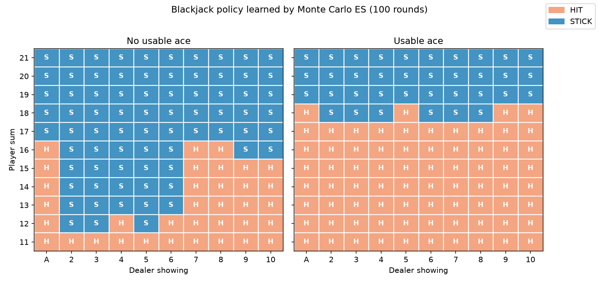
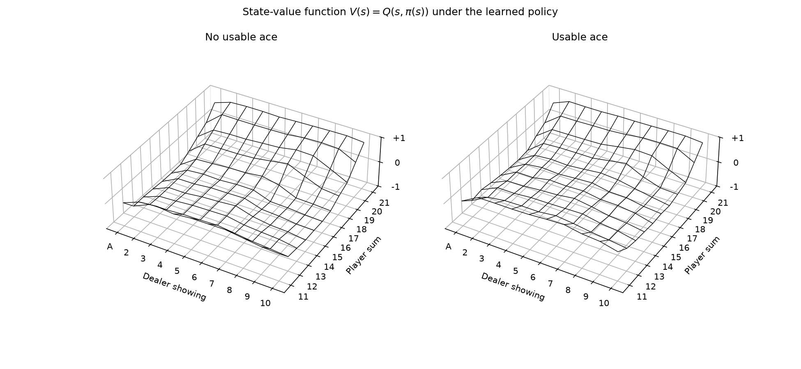

# SoapBubble 与 Blackjack 蒙特卡洛方法实验报告

## 1. 问题描述

本实验包含 Sutton & Barto《Reinforcement Learning: An Introduction》第 5 章的两个蒙特卡洛（Monte Carlo, MC）任务：

1. **SoapBubble**（P95, Example 5.2）：给定边界高度函数的肥皂泡模型，稳态下每个内部点的高度等于其上下左右四个邻居高度的平均值。要求用**蒙特卡洛估计**（`SoapBubble::inner_heights_mc`）计算内部各点高度，并与动态规划方法（`inner_heights_dp`）的参考结果对比，误差在 ±0.05 内视为正常。
2. **Blackjack**（P93, Example 5.1 & P99, Example 5.3）：玩家与固定策略（点数 $\geq 17$ 停牌，否则要牌）的庄家对局。要求用**带探索起点的蒙特卡洛控制**（Monte Carlo ES）学习玩家的最优对策，实现 `BlackjackPolicyLearnableDefault::update_value` 与 `update_policy`，输出可对照书上 P100 Figure 5.2 的最优策略表。

两个任务的共同点：环境的转移规律对智能体**不可解析获得**（或计算代价过高），只能通过大量采样，用样本均值逼近期望。

## 2. SoapBubble：蒙特卡洛估计

### 2.1 原理：调和性质与随机游走的对偶

设 $h(p)$ 为点 $p$ 的稳态高度。边界点高度给定 $h(b)=f(b)$，内部点满足离散调和方程：

$$
h(p)=\frac{1}{|\mathcal{N}(p)|}\sum_{q\in\mathcal{N}(p)} h(q)
$$

从点 $p$ 出发做对称随机游走（每步等概率向上下左右移动一格），记 $\tau$ 为首次到达边界的时刻，$X_\tau$ 为落点。定义：

$$
u(p)=\mathbb{E}_p\left[f(X_\tau)\right]
$$

可以验证 $u(p)$ 同样满足上述平均值性质（首步分解即得）且边界上与 $f$ 一致。由离散 Dirichlet 问题解的唯一性，$u \equiv h$。因此**从每个内部点出发采样大量随机游走，取首达边界点高度的样本均值，即为该点高度的 MC 估计**：

$$
h(p)\approx \frac{1}{N}\sum_{i=1}^{N} f\!\left(X_{\tau}^{(i)}\right)
$$

这也体现了 MC 与 DP 的本质区别：DP（`inner_heights_dp`）把调和方程直接当作迭代规则，用邻居的**当前估计**反复更新（bootstrap）；MC 不依赖任何其他点的估计，每个点的值独立地由完整随机游走的样本平均得到。

### 2.2 蒙特卡洛与动态规划的等价性

初看两种方法很难相信它们会给出同一个答案：DP 需要在网格上反复扫描、信息一格格地从边界向内部传播；而 MC 对每个点**各自独立**采样，点与点之间完全不交换信息。二者等价的根本原因在于：**它们求解的是同一个离散 Dirichlet 问题**。

1. **目标相同**：DP 迭代的不动点满足调和方程 + 边界条件；MC 估计的期望 $u(p)=\mathbb{E}_p[f(X_\tau)]$ 由首步分解可知同样满足调和方程 + 边界条件。
2. **解唯一**：离散 Dirichlet 问题的解唯一，因此任何"满足方程 + 边界"的候选解必然就是 $h$ 本身。两种方法只是在用不同方式逼近这**同一个**解。
3. **信息传播的两种形态**：DP 中边界信息靠逐次扫描显式传播（这正是它要迭代 50 万步的原因）；MC 中信息传播由随机游走**隐式完成**——从 $p$ 出发的游走必然途经邻居点再到达边界，邻居的取值规律已经编码在游走的转移分布与首达点的分布里，无需再借用邻居的估计。

所以"一个 bootstrap、一个不 bootstrap"只是计算策略的差异，不是目标的差异。实验结果（误差 $\leq 0.01$）正是这一等价性的数值验证。

### 2.3 实现要点

- 随机引擎 `std::mt19937`，方向在 4 个邻居中均匀抽取；
- 对每个内部点独立采样 `iter = 500000` 条随机游走，走到边界即停，累计边界高度求均值；
- 只改写内部点，边界值保持不变。

### 2.4 结果

编译运行（`g++ -O2 soapbubble_main.cpp`，约 1.5 s），DP 参考结果：

```text
   -0.69  -0.083  -0.046   -0.56
   -0.43   0.012   -0.12   -0.71    -1.8    -3.6   -0.76   0.073
    0.54    0.68    0.25   -0.31    -0.9    -1.2  -0.088       1
     4.6     1.9    0.76    0.12   -0.24    -0.2    0.57       2     5.3
             1.7    0.76    0.25   0.017   0.086    0.53     1.2     1.7
            0.36    0.33    0.13  -0.033 -0.0076    0.26    0.53    0.44
          -0.062   0.079  -0.036   -0.27   -0.34  -0.021    0.22   0.015
           0.049   0.085  -0.083   -0.67    -1.1   -0.22    0.36    0.36   -0.22
                            0.29    -1.3      -3   -0.17     1.1     1.3     0.5
                                                             2.9     3.1     2.8
```

MC 估计结果：

```text
   -0.69  -0.083  -0.046   -0.56
   -0.43  0.0098   -0.12   -0.71    -1.8    -3.6   -0.76   0.073
    0.54    0.69    0.25   -0.31    -0.9    -1.2  -0.088       1
     4.6     1.9    0.76    0.12   -0.25   -0.19    0.57       2     5.3
             1.7    0.76    0.26   0.018   0.086    0.53     1.2     1.7
            0.36    0.33    0.13  -0.033 -0.0061    0.26    0.53    0.44
          -0.062   0.082  -0.035   -0.27   -0.34  -0.025    0.22   0.015
           0.049   0.085  -0.083   -0.67    -1.1   -0.22    0.36    0.36   -0.22
                            0.29    -1.3      -3   -0.17     1.1     1.3     0.5
                                                             2.9     3.1     2.8
```

逐点对比两种方法，**最大绝对误差为 0.01**，远小于 ±0.05 的要求——2.2 节所述的等价性得到了数值验证。

## 3. Blackjack：带探索起点的蒙特卡洛控制

### 3.1 问题建模

对玩家（智能体）而言，决策可依据的观测为三元组：

$$
s=(\textit{dealer\_shown},\ \textit{player\_ace},\ \textit{player\_sum})
$$

即庄家明牌（A~10）、自己是否有可用 A、自己当前点数（有决策意义的范围为 11~20）。动作 $a\in\{\text{HIT},\text{STICK}\}$。奖励只在终局给出：胜 $+1$、负 $-1$、平 $0$；折扣因子 $\gamma=1$。庄家策略固定（$\geq 17$ 停），因此庄家与发牌随机性一起归入**环境动态**；庄家暗牌对玩家不可见，问题是部分可观测的。

### 3.2 算法：Monte Carlo ES 策略迭代

采用书上 5.3 节的 Monte Carlo ES（Exploring Starts）算法，反复执行"评估 → 改进"：

**策略评估**（`update_value`）：对当前策略 $\pi$，用首次访问 MC 估计动作价值 $Q(s,a)$。枚举所有起点——每个初始状态 $(\textit{dealer\_shown},\textit{player\_ace},\textit{player\_sum})$ 与每个首动作 $a_0$ 的组合（共 $10\times2\times10\times2=400$ 个），每个起点模拟 $n$ 局。一局结束后得到回报 $G$，对轨迹中每个 $(s,a)$ 做增量平均：

$$
N(s,a)\leftarrow N(s,a)+1,\qquad
Q(s,a)\leftarrow Q(s,a)+\frac{G-Q(s,a)}{N(s,a)}
$$

**策略改进**（`update_policy`）：对每个状态取贪心动作

$$
\pi(s)\leftarrow\arg\max_{a}\,Q(s,a)
$$

探索起点假设（每个 $(s,a)$ 都被强制作为开局采样）保证了所有动作价值都能被评估，贪心改进可以持续进行，策略最终收敛到最优。

### 3.3 实现要点

- **开局**：`Blackjack::reset(dealer_shown, player_ace, player_sum)` 固定玩家观测三元组，庄家暗牌随机补抽——同一观测起点在不同模拟局中对应不同的环境随机实现，大数定律保证样本均值收敛到期望；
- **轨迹**：只记录**玩家的步** $(s,a)$，庄家的步是环境动态的一部分，不参与更新；
- **回溯**：从轨迹末尾向前扫描更新（标准形式 $G\leftarrow\gamma G+r$；本问题步间奖励全 0、$\gamma=1$，故 $G$ 恒等于终局奖励，直接取 `StepResult.player_reward`）。玩家一局内不会重复访问同一 $(s,a)$，天然满足"首次访问"，无需判重（理由详见 3.4 节）；
- **超参数**：策略迭代 100 轮，每轮每个起点模拟 $n=1000$ 局（每轮约 40 万局，总计 4000 万局，运行约 3 s）。

### 3.4 为什么首次访问 MC 在这里无需判重

首次访问 MC 的通用定义要求：一条轨迹中若同一 $(s,a)$ 出现多次，只用**第一次**出现之后的回报参与平均，以避免同一局内重复样本之间的相关性。在 Gridworld 这类可以绕圈回到旧状态的任务里，实现时必须在回溯中逐一检查 $(s,a)$ 是否已在更早的步出现过。

本问题中这个判重步骤可以安全省略，因为**同一 $(s,a)$ 在一局之内不可能出现两次**。玩家状态为 $(\textit{dealer\_shown},\textit{player\_ace},\textit{player\_sum})$，其中庄家明牌整局固定，而 $(\textit{player\_sum},\textit{player\_ace})$ 的演化保证不回头：

1. **软点数阶段**（有可用 A）：每次 HIT 后只要不爆，A 按 11 计，点数**严格递增**；
2. **A 的退化一局至多一次**：退化（A 从 11 变 1）发生后点数 $\geq 12$，此后抽 A 只能按 1 计，ace 标志永远停在 false；
3. **硬点数阶段**（无可用 A）：每次 HIT 点数同样**严格递增**。

两阶段即使出现相同点数，ace 标志也必然不同（true/false 各一次退化翻转），属于不同状态。因此一局内访问的所有玩家状态互不相同——**首次访问 MC 与每次访问 MC 在此天然等价**，直接对整条轨迹回溯更新即可。

需要强调的是，这个化简来自本问题"状态只能沿点数单调推进"的特殊结构，而非首次访问 MC 的普遍性质；换到状态可重复的任务，判重逻辑必不可少。

### 3.5 结果

最终策略表如下（行：玩家点数 21→11；列：庄家明牌 A,2,…,9,T；左：无可用 A；右：有可用 A；H=要牌，S=停牌）：

```text
Player Without Ace              Player With Usable Ace.
SSSSSSSSSS                      SSSSSSSSSS      (21)
SSSSSSSSSS                      SSSSSSSSSS      (20)
SSSSSSSSSS                      SSSSSSSSSS      (19)
SSSSSSSSSS                      HSSSHSSSHS      (18)
SSSSSSSSSS                      HHHHHHHHHH      (17)
HSSSSSHHHH                      HHHHHHHHHH      (16)
HSSSSSHHHH                      HHHHHHHHHH      (15)
HSSSSSHHHH                      HHHHHHHHHH      (14)
HHSSSSHHHH                      HHHHHHHHHH      (13)
HHHHSSHHHH                      HHHHHHHHHH      (12)
HHHHHHHHHH                      HHHHHHHHHH      (11)
```

最终策略下的状态价值表 $V(s)=Q(s,\pi(s))$（行：玩家点数 21→11；列：庄家明牌 A→T）：

```text
Player Without Ace
  0.67  0.89  0.88  0.88  0.89  0.90  0.93  0.94  0.93  0.88   (21)
  0.13  0.63  0.64  0.64  0.66  0.71  0.74  0.80  0.77  0.43   (20)
 -0.14  0.39  0.43  0.42  0.46  0.50  0.59  0.61  0.27 -0.03   (19)
 -0.37  0.14  0.15  0.16  0.20  0.26  0.40  0.10 -0.18 -0.24   (18)
 -0.66 -0.13 -0.09 -0.10 -0.05  0.04 -0.11 -0.38 -0.42 -0.46   (17)
 -0.64 -0.29 -0.22 -0.21 -0.19 -0.11 -0.43 -0.44 -0.51 -0.56   (16)
 -0.61 -0.28 -0.22 -0.19 -0.17 -0.12 -0.35 -0.42 -0.47 -0.47   (15)
 -0.59 -0.30 -0.26 -0.18 -0.17 -0.17 -0.35 -0.37 -0.42 -0.52   (14)
 -0.55 -0.32 -0.24 -0.24 -0.17 -0.17 -0.28 -0.34 -0.41 -0.49   (13)
 -0.52 -0.24 -0.21 -0.19 -0.17 -0.13 -0.22 -0.24 -0.34 -0.44   (12)
 -0.10  0.24  0.24  0.31  0.33  0.32  0.26  0.30  0.15  0.08   (11)
```

```text
Player With Usable Ace
  0.65  0.88  0.87  0.88  0.90  0.90  0.93  0.93  0.95  0.89   (21)
  0.12  0.64  0.65  0.66  0.65  0.70  0.78  0.80  0.75  0.45   (20)
 -0.14  0.44  0.43  0.41  0.46  0.50  0.60  0.58  0.27 -0.01   (19)
 -0.34  0.11  0.12  0.15  0.18  0.30  0.41  0.08 -0.08 -0.23   (18)
 -0.42  0.03  0.06  0.03  0.09  0.14  0.04 -0.05 -0.17 -0.28   (17)
 -0.38  0.01 -0.02  0.02  0.07  0.07  0.00 -0.09 -0.13 -0.27   (16)
 -0.36  0.03  0.09  0.02  0.09  0.09  0.03 -0.03 -0.09 -0.21   (15)
 -0.36  0.03  0.07  0.08  0.07  0.14  0.11 -0.00 -0.03 -0.19   (14)
 -0.34  0.00  0.09  0.13  0.12  0.10  0.12  0.08 -0.08 -0.15   (13)
 -0.31  0.08  0.07  0.12  0.15  0.20  0.13  0.13 -0.07 -0.10   (12)
  0.01  0.35  0.39  0.40  0.40  0.46  0.46  0.44  0.35  0.18   (11)
```

策略表的可视化（蓝色 STICK、橙色 HIT）：



价值函数的线框曲面：



### 3.6 与书上 Figure 5.2 的对照与分析

策略结构与书上最优策略 $\pi_*$ 一致：

- **无可用 A**：17 点以上必停；13~16 点对庄家弱明牌（2~6，庄家易爆）停牌、对强明牌（7~T,A）要牌；11 点以下必要牌；
- **有可用 A**：19 点以上停牌；软 17 及以下一直要牌（A 可退化为 1，无爆点风险）；软 18 附近停/要混合。
- 个别格子（如软 18 对 5/T、硬 12 对 4、硬 13 对 2）与书上略有出入：这些状态下 HIT 与 STICK 的价值差在 0.05 以内，属近乎平局的动作对，有限采样下贪心选择会在等价动作间抖动，不影响策略的期望表现。

训练过程中策略表从第 20 轮到第 100 轮已基本稳定，只有上述近平局格子偶有翻转，说明 MC ES 收敛良好。

价值表印证了游戏规则的不对称性：

- **绝大多数状态价值为负**（如硬 16 对庄家明牌 T 为 $-0.56$）：玩家先行动且爆点立即判负（即使庄家随后也会爆），规则天然偏向庄家；
- **20、21 点价值显著为正**（最高约 $+0.9$）：高点数下玩家优势巨大；
- **庄家明牌 A 一列价值最低**（如硬 17 对 A 为 $-0.64$）：A 可 1 可 11，庄家成牌率高，玩家几乎只能寄希望于庄家爆点；
- **有可用 A 的同点数状态价值普遍高于无 A**（如 17 点对 2：$-0.29$ vs $+0.01$）：A 的"退化免爆"机制提供了免费再抽一张的保险。

## 4. 总结

本实验用蒙特卡洛方法解决了两类问题：

| | SoapBubble | Blackjack |
|---|---|---|
| 任务类型 | 价值**估计**（给定方程求值） | 最优**控制**（策略迭代求 $\pi_*$） |
| 采样对象 | 随机游走至边界的轨迹 | 完整对局的玩家轨迹 |
| 估计目标 | 内部点高度 $\mathbb{E}[f(X_\tau)]$ | 动作价值 $Q(s,a)=\mathbb{E}[G\mid s,a]$ |
| 对照基准 | DP 迭代解（误差 $\leq 0.01$） | 书上 Figure 5.2 最优策略（结构一致） |

两者的共同思想是：**在模型未知或解析求解代价过高时，用大量独立采样的均值逼近期望**。同时 MC 不做 bootstrap——评估阶段各状态（各点）的估计相互独立，这也带来了实现上的自由度（采样顺序可任意重排）。与前几章的 DP 方法相比，MC 以"采样成本"换取了"免模型"的通用性，是强化学习从规划走向学习的关键一步。
